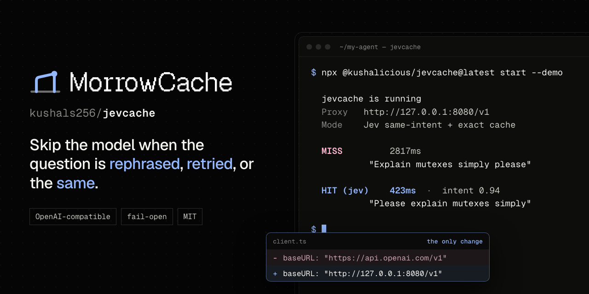
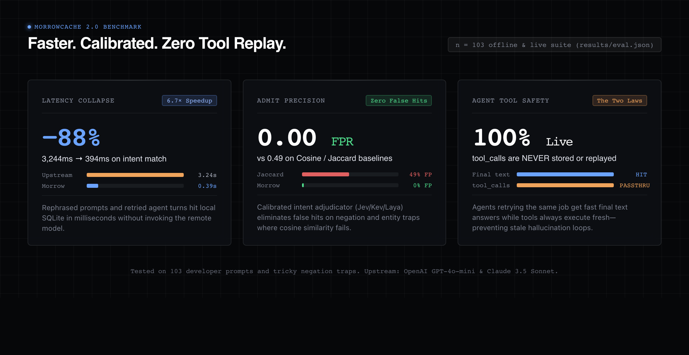
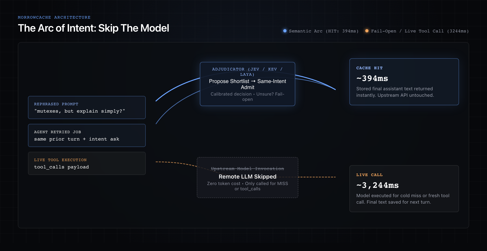
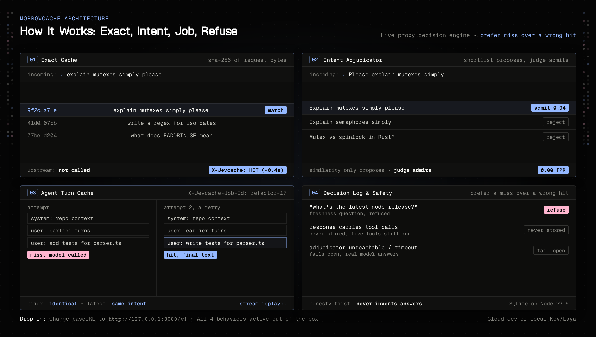
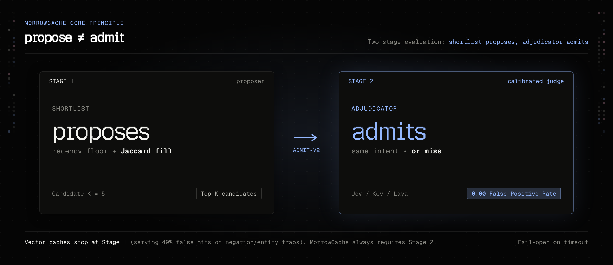
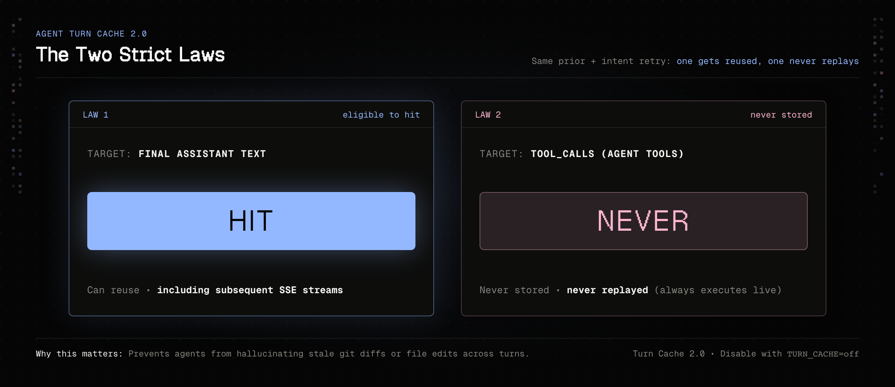
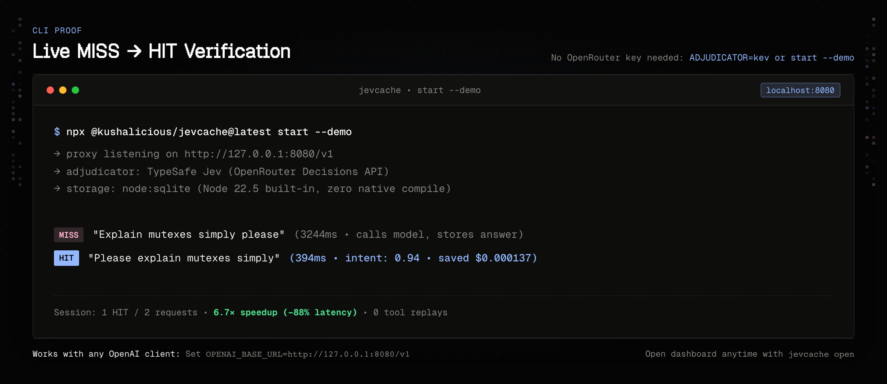

# MorrowCache

<p align="center">
  
</p>

<p align="center">
  <a href="https://www.npmjs.com/package/@kushalicious/jevcache"></a>
  <a href="https://www.npmjs.com/package/@kushalicious/jevcache"></a>
  <a href="https://github.com/kushals256/jevcache/pkgs/container/jevcache"></a>
  <a href="./LICENSE"></a>
  <a href="https://morrowcache.vercel.app"></a>
</p>

<p align="center">
  <strong>Routers pick a model. This proxy decides whether to call one.</strong>
</p>

An open-source **semantic cache and Agent Turn Cache for OpenAI-compatible LLM APIs**: run it locally, change your client's `baseURL`, and repeated or paraphrased questions—as well as multi-step agent retries—are served in milliseconds from cache instead of paying the model again.

* **Package & CLI:** `@kushalicious/jevcache` / `jevcache`
* **Site:** [morrowcache.vercel.app](https://morrowcache.vercel.app)
* **Agent Spec:** [morrowcache.vercel.app/llms.txt](https://morrowcache.vercel.app/llms.txt)

---

## Benchmark: Faster. Calibrated. Zero Tool Replay.

<p align="center">
  
</p>

```text
call 1  "Explain mutexes simply please"     →  MISS   ~3244ms   (calls the model, stores answer)
call 2  "Please explain mutexes simply"     →  HIT     ~394ms   (same intent · 6.7× faster · saved $)
```

* **Latency Collapse (−88%):** Identical asks and paraphrases resolve locally in ~394ms.
* **Calibrated Admit (0.00 FPR):** Tested on 103 tricky negation and entity traps (`results/eval.json`). While standard vector/Jaccard caches suffer a **~49% false-positive rate**, MorrowCache achieves **0.00**.
* **Zero Tool Hallucination:** Final assistant text hits; `tool_calls` are **never stored or replayed**—guaranteeing tools always execute live.

---

## How It Works: The Arc of Intent

<p align="center">
  
</p>

MorrowCache sits locally on your machine between your coding agents (Cursor, Claude Code, Windsurf) and your LLM endpoints. Instead of calling expensive remote models for repeated turns or reworded questions, it routes requests through a two-tier decision arch:

1. **The Semantic Arc (Cache HIT ~394ms):**  
   Rephrased user asks and agent job retries are matched against cached priors. The intent adjudicator (cloud Jev or local Kev/Laya) confirms calibrated same-intent and freshness—jumping cleanly over the remote model to return the stored answer instantly.
2. **The Live Execution Channel (Model Invocation ~3244ms):**  
   Novel prompts, cold misses, and live tool calls (`tool_calls`) pass straight through to the upstream provider. Final assistant text is admitted to the cache for future turns; tool calls are never cached. Fail-open ensures that if an adjudicator times out, your workflow is never interrupted.

<p align="center">
  
</p>

### System Architecture

MorrowCache sits locally between your coding agents (Cursor, Claude Code, Windsurf) or application clients and your upstream LLM provider:

```text
┌────────────────────────────────────────────────────────────────────────────────────────┐
│ Coding Agents & LLM Clients                                                            │
│ (Claude Code, Cursor, Windsurf, Vercel AI SDK, OpenAI SDK, LangChain, Ollama)          │
└───────────────────────────────────────────┬────────────────────────────────────────────┘
                                            │
                             baseURL: http://127.0.0.1:8080/v1
                                            ▼
┌────────────────────────────────────────────────────────────────────────────────────────┐
│ MorrowCache Proxy (localhost:8080)                                                     │
│                                                                                        │
│  [1] Request Guard & Freshness Policy                                                  │
│      ├── Bypasses live/audio/logprobs/forced-tools                                     │
│      └── Checks freshness TTL (rejects stale answers)                                  │
│                                                                                        │
│  [2] Exact SHA-256 Cache ─────────────────────────(Exact match)──────► [ HIT: ~400ms ] │
│         │ (Miss / Paraphrase)                                                          │
│         ▼                                                                              │
│  [3] Candidate Shortlist (Hybrid Recency + Jaccard Fill)                               │
│         │ (Top-K candidates)                                                           │
│         ▼                                                                              │
│  [4] Intent Adjudicator (Cloud Jev / Local Kev / Laya / System One)                    │
│         ├── (Same Intent + Fresh) ───────────────────────────────────► [ HIT: ~400ms ] │
│         └── (Different Intent / Error / Timeout)                                       │
│                    │                                                                   │
│                    ▼ (Fail-Open)                                                       │
└────────────────────┼───────────────────────────────────────────────────────────────────┘
                     │
                     ▼
┌────────────────────────────────────────────────────────────────────────────────────────┐
│ Upstream Model Provider (OpenRouter / OpenAI / Anthropic / Local System One)           │
│                                                                                        │
│  • Computes full completion (~3200ms)                                                  │
│  • Returns response to MorrowCache:                                                    │
│      ├── Final Assistant Text  ──► Stored in Cache for subsequent HITs                 │
│      └── Tool Calls (tool_calls) ──► Returned immediately; NEVER STORED / REPLAYED     │
└────────────────────────────────────────────────────────────────────────────────────────┘
```

---

## Core Innovations

### 1. Propose ≠ Admit

Most semantic caches rely solely on vector embeddings and cosine thresholds. In developer tasks, cosine similarity fails on subtle yet critical distinctions:

<p align="center">
  
</p>

| Approach | Negation / Entity Trap ("Explain mutex" vs "Explain semaphore") | False-Positive Rate |
| :--- | :--- | :--- |
| **Exact Hash Only** | Misses all paraphrases | `0.00` (blind to rephrasing) |
| **Vector / Word Overlap (Jaccard @ 0.35)** | Treats shared words as match → **Wrong answer served** | **~0.48** (high risk) |
| **MorrowCache (Propose + Intent Admit)** | Shortlist proposes; Adjudicator confirms exact intent | **0.00** (calibrated admit) |

> **Published benchmark:** On live Jev runs ($n=100$), false-positive rate was **0.00** vs baseline Jaccard **~0.48**. See [`results/eval.json`](./results/eval.json).

---

### 2. Agent Turn Cache 2.0 (The Two Laws)

AI coding agents frequently retry or continue loops where prior tool calls and questions repeat. MorrowCache 2.0 handles agent turns with two strict laws:

<p align="center">
  
</p>

```text
┌────────────────────────────────────────────────────────────────────────────────────────┐
│ Agent Turn Cache Mechanics                                                             │
├────────────────────────────────────────────────┬───────────────────────────────────────┤
│ LAW 1: Final Assistant Text                    │ LAW 2: Tool Calls (tool_calls)        │
├────────────────────────────────────────────────┼───────────────────────────────────────┤
│ • Same prior conversation context              │ • Agent requests tool execution       │
│ • Paraphrased or identical final ask           │ • Tool outputs must always be live    │
│ • Result: CACHE HIT (fast, $0 cost)            │ • Result: ALWAYS CALL UPSTREAM        │
│ • Subsequent streaming of final answer can HIT │ • NEVER STORED · NEVER REPLAYED       │
└────────────────────────────────────────────────┴───────────────────────────────────────┘
```

| Scenario | Behavior |
| --- | --- |
| Same prior + paraphrased last user message | **HIT** (`turn_exact` or `turn_jev`) |
| Different tool history | Intent HIT will **not** cross mismatched priors |
| `X-Jevcache-Job-Id` | Optional job label; does not cross priors unless `JOB_CROSS_PRIOR=on` |
| Stream of a stored final answer | **HIT** as SSE (`data: [DONE]`). First stream is still a MISS |
| Model returns `tool_calls` | **MISS** (reason: `tool_calls`), payload never stored |
| `TURN_CACHE=off` | 1.x legacy behavior: stream, tools schema, and tool history bypass |

---

## Adjudicator Backends

Run in the cloud via OpenRouter, or run completely offline on your local machine:

| Mode | Env | Needs OpenRouter for Admit? | Description |
| :--- | :--- | :---: | :--- |
| **Jev** *(default)* | *(omit `ADJUDICATOR`)* | **Yes** (`OPENROUTER_API_KEY`) | TypeSafe Jev via OpenRouter Decisions |
| **Kev** *(local)* | `ADJUDICATOR=kev` | **No** (Localhost) | Default `http://127.0.0.1:8008`, model `kev-latest` |
| **Laya** *(local)* | `ADJUDICATOR=laya` | **No** (Localhost) | Default `http://127.0.0.1:8000`, model `laya-latest` |
| **Laya MLX** | `ADJUDICATOR=laya-mlx` | **No** (Localhost) | Local Apple Silicon MLX backend |
| **Any System One** | `ADJUDICATOR=systemone` | **No** | Point to any System One compatible server |
| **None** *(exact-only)* | `ADJUDICATOR=none` | **No** | Strict SHA-256 matching only |

```bash
# Run with local Kev (zero cloud key needed for semantic admits)
ADJUDICATOR=kev npx @kushalicious/jevcache@latest start

# Run with local Laya
ADJUDICATOR=laya npx @kushalicious/jevcache@latest start
```

---

## 30-Second Quickstart

Try it right now in your terminal:

```bash
npx @kushalicious/jevcache@latest start --demo
```

<p align="center">
  
</p>

This launches the proxy, tests a live **MISS → HIT**, and prints real latency collapse:

```
[jevcache] MISS  Explain mutexes simply please  (3244ms)
[jevcache] HIT   Please explain mutexes simply  (394ms, intent: 0.94)
```

| Service | Address |
| --- | --- |
| **Proxy Endpoint** | `http://127.0.0.1:8080/v1` |
| **Web Dashboard & Stats** | [http://127.0.0.1:8080/stats](http://127.0.0.1:8080/stats) (`jevcache open`) |
| **npm Package** | [`@kushalicious/jevcache`](https://www.npmjs.com/package/@kushalicious/jevcache) |
| **Docker Image** | `ghcr.io/kushals256/jevcache:latest` |

---

## Wire Your Application (1-Line Change)

Automate `.env` configuration:
```bash
npx @kushalicious/jevcache init
```

Or configure your client directly:

### OpenAI Node / TypeScript SDK
```typescript
import OpenAI from "openai";

const client = new OpenAI({
  apiKey: process.env.OPENROUTER_API_KEY,
  baseURL: "http://127.0.0.1:8080/v1", // ← point to MorrowCache
});
```

### Python / Environment Variables
```bash
export OPENAI_BASE_URL="http://127.0.0.1:8080/v1"
export OPENAI_API_KEY="$OPENROUTER_API_KEY"
```

---

## Claude Code Plugin

Install the official MorrowCache plugin for [Claude Code](https://github.com/anthropics/claude-code):

```bash
/plugin marketplace add kushals256/jevcache
/plugin install morrowcache@morrowcache
```

* Run `/morrowcache:setup` in your project: Claude inspects your code, configures the base URL, and runs `jevcache verify`.
* Run `/morrowcache:stats` to view live hit rates and token savings.

---

## Cursor / Coding Agent Setup

Copy and paste the prompt below into a new Cursor or Windsurf chat. The agent will configure everything end-to-end:

<details>
<summary><strong>Click to expand Agent Setup Prompt</strong></summary>

```text
You are setting up MorrowCache (npm: @kushalicious/jevcache) for me in this project.

Goal: run MorrowCache 2.0, a local OpenAI-compatible proxy. It skips the model when a same-intent adjudicator admits a paraphrase (not cosine), and when an agent retries the same job (same prior + same-intent latest ask). It stores final text only, including a later stream of that answer. It never stores tool_calls. Default judge = cloud TypeSafe Jev; local Kev / Laya / Laya MLX / any System One also supported. Set TURN_CACHE=off to restore 1.x stream/tools bypass.

Repo: https://github.com/kushals256/jevcache
npm: npx @kushalicious/jevcache@latest
Site: https://morrowcache.vercel.app/agent-setup

Do ALL of the following without asking me to run terminal commands myself (you run them):

1. Check Node.js >= 22.5. If missing, tell me how to install it in one step for my OS.
2. Prefer the easiest install that works:
   a) Try: npx --yes @kushalicious/jevcache@latest doctor
      (fallback: npx --yes github:kushals256/jevcache doctor)
   b) If that fails, use Docker with ghcr.io/kushals256/jevcache:latest on port 8080
   c) Or clone into ../jevcache, npm install, npm run build.
3. Ask me ONCE which adjudicator path I want:
   A) Cloud Jev (default) — need OPENROUTER_API_KEY for same-intent admits
   B) Local Kev / Laya / Laya MLX / System One — set ADJUDICATOR=kev|laya|laya-mlx|systemone;
      no OpenRouter key required for admits. For systemone also set ADJUDICATOR_URL + ADJUDICATOR_MODEL.
   If neither path is ready, warn that the proxy will run EXACT-ONLY (paraphrases will MISS).
4. Ask for an upstream chat API key if needed for real completions, or use MOCK_UPSTREAM=1 for a synthetic demo.
   Save secrets to .env (never commit; ensure .gitignore has .env).
5. Run: npx @kushalicious/jevcache init  (writes OPENAI_BASE_URL into .env)
6. Start MorrowCache in the background on http://127.0.0.1:8080 (or PORT if set). Verify GET /healthz.
   Prefer: npx @kushalicious/jevcache doctor --live
7. Wire THIS app so OpenAI-compatible clients use baseURL "http://127.0.0.1:8080/v1".
8. Add SETUP_JEVCACHE.md with start command, ADJUDICATOR kind, baseURL, and /stats link.
9. Optionally add .cursor/rules/jevcache.mdc so future agents keep that baseURL.
10. Prove it: paraphrased prompts → expect MISS then HIT (or run start --demo). Show X-Jevcache headers or /stats.
    Final text may HIT, including a later stream of the same answer. tool_calls are never stored. Optional header X-Jevcache-Job-Id groups a job without crossing priors unless JOB_CROSS_PRIOR=on. Chat Completions only; /v1/responses is 501.

Do not commit secrets. If install fails, try the next method (npx → docker → clone).
When done, tell me: start command, ADJUDICATOR kind, baseURL, key locations (not values), whether MISS → HIT passed, stats URL.
```
</details>

---

## CLI Reference

```bash
npx @kushalicious/jevcache init              # Write .env + OPENAI_BASE_URL
npx @kushalicious/jevcache doctor            # Check API keys and configuration
npx @kushalicious/jevcache doctor --live     # Check /healthz, Jev admit, & upstream
npx @kushalicious/jevcache start             # Start the local proxy
npx @kushalicious/jevcache start --demo      # Run live MISS → HIT demo
npx @kushalicious/jevcache status            # View running status, hit rate & savings
npx @kushalicious/jevcache verify --model=openai/gpt-4o-mini   # MISS → reworded → exact HIT
npx @kushalicious/jevcache open              # Open the /stats dashboard in your browser
```

### Response Headers

| Header | Meaning |
| :--- | :--- |
| `X-Jevcache` | `HIT`, `MISS`, or `BYPASS` |
| `X-Jevcache-Tier` | `exact`, `jev`, `turn_exact`, or `turn_jev` |
| `X-Jevcache-Reason` | Detail on why a request missed or bypassed (`tool_calls`, `freshness_stale`, `freshness_live`, etc.) |
| `X-Jevcache-Job-Id` | Optional job label to group turns |
| `X-Jevcache-Bypass: 1` | Pass in request to skip cache and force upstream execution |
| `X-Jevcache-Tenant` | Tenant isolation key |

---

## Docker

Run MorrowCache in Docker without modifying local Node dependencies:

```bash
docker run --rm -p 8080:8080 \
  -e OPENROUTER_API_KEY=$OPENROUTER_API_KEY \
  -e UPSTREAM_API_KEY=$OPENROUTER_API_KEY \
  ghcr.io/kushals256/jevcache:latest
```

*(Note: SQLite is single-process; run a single replica per database volume).*

---

## Verification & Honesty

- **Honest Metrics:** On live Jev runs ($n=100$), false-positive rate was **0.00** vs Jaccard@0.35 baseline **~0.48**. Re-run tests anytime with `npm run eval` or `LIVE=1 npm run eval`.
- **Zero Native SQLite Compiles:** Powered by Node.js built-in `node:sqlite` (Node ≥ 22.5).
- **Fail-Open Guarantee:** If an adjudicator experiences high latency, outage, or errors, MorrowCache passes requests directly to your upstream LLM unhindered.

---

## Links & Community

* **Web:** [morrowcache.vercel.app](https://morrowcache.vercel.app)
* **npm:** [@kushalicious/jevcache](https://www.npmjs.com/package/@kushalicious/jevcache)
* **Agent Setup Guide:** [`AGENT_SETUP.md`](./AGENT_SETUP.md)
* **Security & Privacy:** [`SECURITY.md`](./SECURITY.md)
* **Contributing:** [`CONTRIBUTING.md`](./CONTRIBUTING.md)
* **Changelog:** [`CHANGELOG.md`](./CHANGELOG.md)

---

## License

[MIT](./LICENSE)
